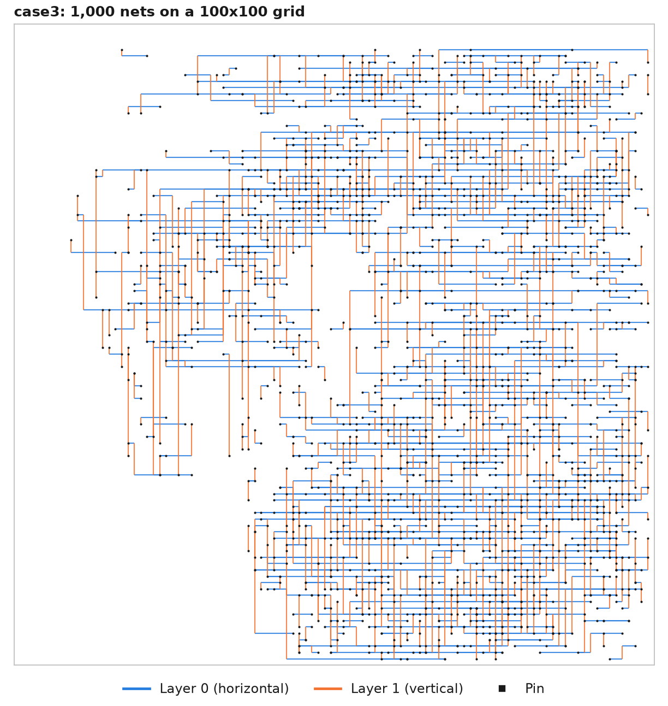
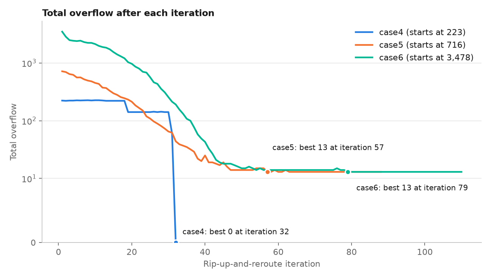
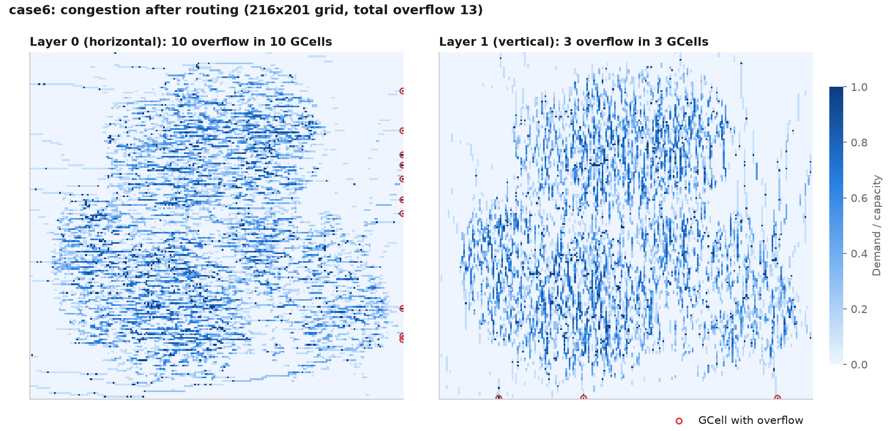

# Global Router

A two-layer global router for two-pin nets, written in C++17. It uses negotiation-based rip-up and reroute to minimize routing overflow first and wirelength second.

This was Programming Assignment 3 of the Algorithms course (Fall 2025) at National Taiwan University, Department of Electrical Engineering. The problem is modified from the ISPD 2024 Global Routing Contest.

<p align="center">
  
</p>

## Problem

The routing region is a grid of global cells (GCells) on two metal layers, one horizontal and one vertical. Each GCell has a capacity. Each net connects two pins, and a path may move along a layer's preferred direction or change layers through a via.

- **Demand** of a GCell is the number of distinct nets that pass through it.
- **Overflow** of a GCell is `max(0, demand - capacity)`.
- **Primary objective**: minimize total overflow.
- **Secondary objective**: minimize total wirelength, including a fixed cost per via.
- **Runtime limit**: 10 minutes per case.

`PA3.pdf` has the full specification and file formats.

## Approach

### Flow

1. **Initial routing.** Nets are sorted by half-perimeter wirelength, longest first, and routed one by one on the empty grid.
2. **Rip-up and reroute.** In each iteration every net is removed, rerouted against the current congestion costs, and put back. This repeats for up to 150 iterations.
3. **Best-solution tracking.** The solution with the lowest overflow seen so far is kept and written out at the end.

### Cost function

The cost of entering GCell `n` is

```
cost(n) = (base + history(n) + noise) * (1 + pres_fac * (2^overflow - 1))
```

- **base** is 100 and stands for the wirelength of one step.
- **history(n)** grows by 100 every iteration in which the cell overflows, so cells that stay congested become more expensive over time.
- **noise** is a random value up to 5% of the history term. It breaks ties between symmetric paths that would otherwise keep swapping.
- **pres_fac** starts at 1.0 and grows by 10% per iteration, so congestion matters more as routing proceeds.
- A cell that is one net below capacity gets a small penalty (`pres_fac * 0.1`) to discourage filling it completely.
- Costs are capped at 4e18 to avoid integer overflow.

### Path search

- **Weighted A\*** (heuristic weight 2.0) is used in early iterations for speed.
- **Dijkstra** (weight 0) takes over when the overflow stops changing or drops below 100, so that the search finds the cheapest detours.

### Net ordering

- While overflow is 200 or more, nets are rerouted in random order.
- Below 200, nets are sorted by how much overflow their current path crosses, worst first, with net ID as the tie-breaker.

### Escaping stagnation

- If the overflow is unchanged for 10 iterations and the best overflow is below 50, the history cost of every overflowing cell is multiplied by 10. This forces the nets there to take a different topology.
- The router stops early when overflow reaches 0, when there has been no improvement for 30 iterations, or when 580 seconds have elapsed.

## Results

All outputs pass the validity and connectivity checks of the course evaluator (`utilities/pa3_evaluator.py`).

| Case | Grid (cols x rows) | Nets | Total overflow | Total cost (wirelength + vias) | Vias | Runtime |
|---|---|---|---|---|---|---|
| case1 | 5 x 4 | 3 | 0 | 59,200 | 4 | < 2 s |
| case2 | 50 x 50 | 200 | 0 | 11,785,600 | 374 | < 2 s |
| case3 | 100 x 100 | 1,000 | 0 | 68,233,400 | 1,750 | < 2 s |
| case4 | 619 x 613 | 103 | 0 | 12,314,800 | 208 | 12 s |
| case5 | 65 x 67 | 1,701 | 13 | 129,797,040 | 3,588 | 12 s |
| case6 | 216 x 201 | 2,000 | 13 | 272,572,890 | 12,019 | 56 s |

Runtimes were measured on a MacBook Air with `-O2`, running the six cases in parallel. The route files for case2 to case6 are in `outputs/`.

### Convergence



- case4 stalls at an overflow of about 140 and then reaches zero at iteration 32, an iteration in which the stalled search runs Dijkstra instead of weighted A*.
- case5 and case6 fall from 716 and 3,478 to 13 and then stop improving. The router ends the run after 30 iterations without a better result.

### Congestion



The 13 remaining overflows of case6 lie on the boundary of the grid, in 10 GCells of the horizontal layer and 3 of the vertical layer.

The figures are drawn by `tools/plot_results.py` from the files in `inputs/` and `outputs/`.

## Build and run

```bash
make clean
make
./bin/router --cap inputs/case5.cap --net inputs/case5.net --out outputs/case5.route
```

Evaluate a result:

```bash
python3 utilities/pa3_evaluator.py inputs/case5.cap inputs/case5.net outputs/case5.route
```

Add `-plot` to the evaluator command to draw the routes.

## Repository layout

| Path | Contents |
|---|---|
| `src/router.cpp` | Routing algorithm: cost model, rip-up and reroute loop, net ordering |
| `src/graph.*` | Grid graph and shortest-path search |
| `src/grid.*`, `src/parser.*`, `src/types.h`, `src/main.cpp` | Grid model, input parsing, entry point |
| `inputs/` | Test cases (`.cap` routing resources, `.net` netlists) |
| `outputs/` | Routing solutions (`.route`) and the router's iteration logs (`logs/`) |
| `tools/plot_results.py` | Draws the figures in this README |
| `figures/` | Routing map, congestion heatmap, convergence curve |
| `utilities/` | Course evaluator, plotting script, submission checker |
| `doc/report.pdf` | Report on data structures, cost function, and strategy |
| `PA3.pdf` | Assignment specification |

## Acknowledgements

The code skeleton, test cases, and utilities were provided by the course staff (instructors Chien-Mo Li, Chin-Lin Wu, and Cheng-Yu Chiang).
